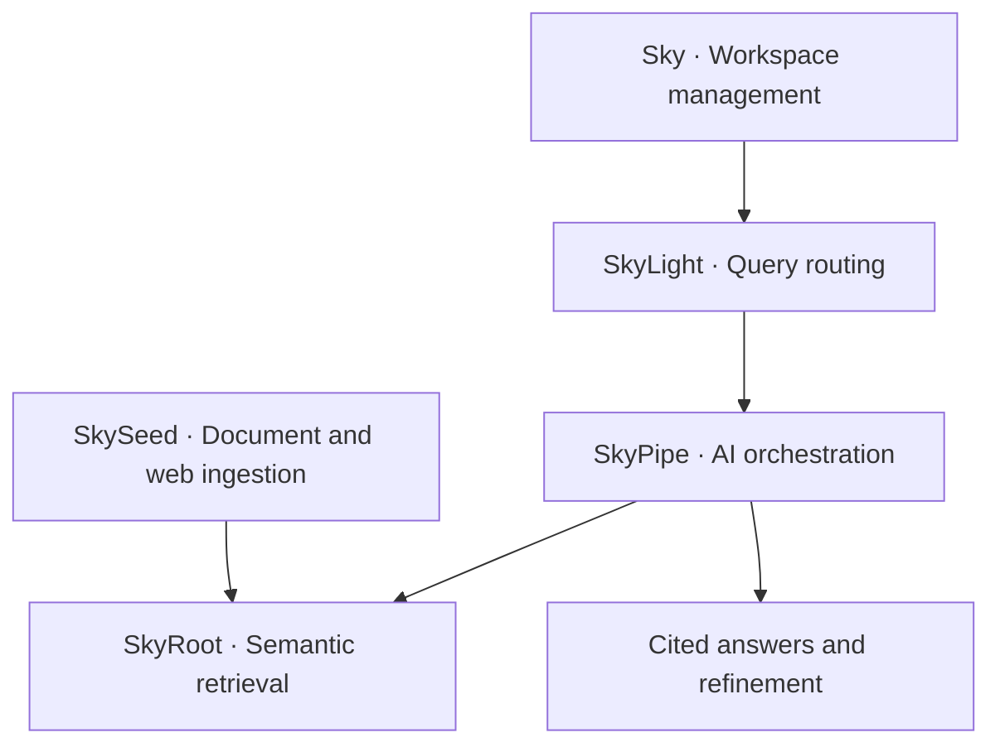

  <h1>👋 Hi, I'm Kapil Nila</h1>
  <h3>Software Engineer · Backend &amp; Distributed Systems · AI Infrastructure · IIT Ropar</h3>
  
Building reliable backend systems, distributed services, and infrastructure for intelligent applications.

  
<strong>Python · FastAPI · PostgreSQL · Distributed Systems · RAG · AI Infrastructure</strong>

  

    
  

  

    
    
    
    
  

  
📍 Bengaluru, India

🚀 About Me
I'm a software engineer and IIT Ropar graduate working at the intersection of backend engineering, distributed systems, and applied AI.

My professional experience includes enterprise RAG systems, semantic retrieval, intent routing, and AI-assisted financial reconciliation. My independent projects explore a different set of challenges: how to preserve correctness under concurrency, design retry-safe APIs, recover from failures, and make intelligent systems easier to debug.

I'm currently building SkyPipe — AI Knowledge OS, a multi-tenant knowledge platform that brings together workspace management, query routing, AI orchestration, semantic retrieval, and document ingestion.

🏗️ Featured Engineering Projects

🌐 Distributed Spatial ID System
A distributed system for generating globally unique, approximately time-sortable 128-bit identifiers for spatial vehicle events, subject to documented worker ownership and recovery assumptions.
Engineering highlights
- Designed a compact 128-bit encoding for timestamps, spatial coordinates, worker IDs, and sequence numbers, with a dependency-free Python library and CLI.
- Implemented durable batch allocation using PostgreSQL transactions, advisory locks, row-level locks, worker leases, and fencing tokens.
- Designed idempotent API retries, clock monotonicity checks, and atomic persistence of allocation state and event records.
- Built a two-replica FastAPI deployment behind Nginx, with Prometheus metrics and controlled network-failure testing using Toxiproxy and an independent recovery watchdog.
- Documented system invariants, failure modes, backup recovery procedures, and the limits of a single-primary PostgreSQL architecture.
Measured development results
Benchmark	Result
Core ID generation — single-thread Windows CLI	89,959 IDs/sec
Durable API — two replicas, 16 clients, 100-ID batches	2,393 IDs/sec
Automated Python and Chromium tests	83
Duplicate IDs observed in measured scenarios	0

Note: Results are from documented development runs, not production capacity guarantees. The CLI benchmark is in-memory; the API benchmark includes durable persistence. See the repository verification report for conditions and limitations.

Stack: Python • FastAPI • PostgreSQL • SQLite • React • TypeScript • Docker • Nginx • Prometheus • Toxiproxy

💰 Bank Reconciliation Engine
A modular transaction matching engine for reconciling bank statements against accounting-system exports through deterministic, heuristic, and AI-assisted matching.
- Multi-format ingestion with schema detection and transaction normalization.
- Exact and hash-based matching, followed by tolerance-based and fuzzy matching for unresolved transactions.
- Candidate indexing using amount buckets, reference clusters, and description-token inverted indices.
- AI-assisted reconciliation for remaining unmatched transactions, rather than invoking an LLM for every record.
Engineering focus: matching algorithms, candidate-space reduction, data normalization, and selective AI escalation.

🔍 X-Ray — Decision Debugger
A Python SDK and dashboard prototype for decision-level observability in multi-step systems such as LLM workflows, ranking engines, and rule-based pipelines.
- Captures structured inputs, outputs, explanations, and candidate evaluations at each pipeline step.
- Provides a reusable step-level instrumentation abstraction and a React dashboard to inspect decisions.
- Demonstrates how to diagnose incorrect selections in a simulated search, filtering, and ranking workflow.
Engineering focus: SDK design, instrumentation, structured execution context, and AI observability.

Stack: Python • FastAPI • React

⚔️ Wuxia Cultivation Platform
A full-stack gamified social platform with transactional user progression, rankings, clans, and community features.
- Uses PostgreSQL row-level locks to serialize concurrent XP awards and daily login updates, with server-enforced activity limits.
- Implements JWT authentication, scoped rate limiting, pagination, resource authorization, and image sanitization.
- Supports private S3-compatible media storage with expiring signed URLs and optional Celery-based Gemini lore generation.
- Provides a Docker Compose stack with non-root containers, health checks, migration and seed jobs, and GitHub Actions checks targeting PostgreSQL and frontend builds.
Engineering focus: transactional consistency, concurrency, authentication, async workflows, and deployment architecture.

Stack: Django REST Framework • Next.js • PostgreSQL • Supabase • Celery • Docker • GitHub Actions

Note: Hosted deployment and CI results require separate verification; the repository documents those steps and current limitations.

🛡️ Trusted AI Governance Platform
A prototype backend that treats LLM output as untrusted and applies explicit risk and policy checks before returning a response.
- Risk detection, rule-based explanations, trust scoring, and selective source grounding.
- Policy actions to allow, warn, or restrict responses, with in-memory audit logging.
- Modular FastAPI architecture with a pluggable LLM integration.
Engineering focus: AI reliability, guardrails, policy enforcement, and auditability.

👨‍💻 Real-Time Pair Programming Platform
A collaborative code editor prototype with live room-based synchronization, persistent editor state, and mocked AI autocomplete.
- Asynchronous FastAPI backend with WebSocket connections and room management.
- PostgreSQL persistence through async SQLAlchemy.
- React and Redux Toolkit frontend with debounced autocomplete requests.
Stack: Python • FastAPI • WebSockets • PostgreSQL • React • TypeScript

🤖 AI Knowledge Inbox
A compact RAG application for storing notes and web content, retrieving relevant passages, and answering questions with source snippets.
- Ingestion, overlapping document chunks, embeddings at write time, and cosine-similarity retrieval.
- Explicit separation of API routes, services, and persistence.
- Documents the trade-off between a transparent SQLite-based prototype and an indexed vector store at scale.
Stack: Python • FastAPI • React • SQLite • OpenAI APIs

🌌 SkyPipe — AI Knowledge OS
A multi-tenant AI knowledge platform built around five architectural layers, with configurable LLM providers and cited answers.
Engineering highlights
- Designed a five-layer architecture separating workspace management, query routing, AI orchestration, retrieval, and knowledge ingestion.
- Implemented semantic retrieval using PostgreSQL and pgvector, with claim-level fact checking, confidence scoring, and bounded critic/refinement loops.
- Built backend infrastructure using FastAPI, async SQLAlchemy, role-based access, API keys, and Stripe billing integration.
- Containerized the platform using Docker Compose and Nginx.
Architecture

Layer	Responsibility

☁️ Sky	Multi-tenant workspace management

💡 SkyLight	Query routing and intent classification

🔗 SkyPipe	AI orchestration and communication

🌳 SkyRoot	Knowledge retrieval and vector search

🌱 SkySeed	Document and web ingestion

Stack: Python • FastAPI • Async SQLAlchemy • PostgreSQL • pgvector • Docker Compose • Nginx • Stripe

Status: Under active development in a private repository. Architecture and implementation details are based on my current project description.

💼 Professional Experience
Software Engineer — AvancerPI
Mar 2026 – Present · Bengaluru, India
- Building an internal RAG system using Python, PostgreSQL, pgvector, and locally hosted Qwen for LLM inference.
- Designed semantic chunking with transformer embeddings to improve retrieval quality for downstream query answering.
- Built internal SDKs and an intent classifier to route queries and simplify developer integration.
- Developed an infrastructure platform unifying integrations across Nutanix, VMware, and SUSE; automated operational workflows with Python and shell scripts.
  
AI & Backend Developer — ABM Nexttech
Feb 2026 – Jul 2026 · Entrepreneurial experience · Remote
- Built a RAG-based transaction matching service combining vector similarity, rule-based heuristics, and Gemini/Anthropic API calls, reducing unmatched transactions by 90%.
- Developed a hybrid matching pipeline using fuzzy logic and embedding similarity for structured transaction data.
- Integrated FastAPI and NestJS services with PostgreSQL and containerized backend services using Docker.
- Owned cloud deployment from development through production rollout.
  
⚡ Tech Stack
Languages
Python · C++ · TypeScript · JavaScript · SQL · Bash
     
Backend & Application Engineering
FastAPI · Django · NestJS · Celery · React · Next.js
     
REST APIs · WebSockets · Async programming · JWT · OAuth
Databases & Retrieval
PostgreSQL · Redis · SQLite · MongoDB · pgvector · Supabase
     
AI Engineering
LangChain · Ollama · OpenAI APIs · Gemini APIs
   
RAG · Semantic search · Embeddings · Intent routing · Qwen · Anthropic API · LLM integration
Infrastructure & DevOps
Docker · Linux · AWS · Nginx · GitHub Actions · Prometheus
     
📚 Engineering Interests
- Distributed systems: concurrency, idempotency, leases, fencing, consistency, and recovery.
- Backend infrastructure: API design, transactional databases, asynchronous processing, observability, and failure testing.
- AI infrastructure: retrieval, agent communication, orchestration, evaluation, and reliable LLM integration.
- Developer tooling: SDKs, debugging tools, and platforms that simplify complex workflows.
  
🏆 Education & Achievements
- 🎓 B.Tech, Electrical Engineering — Indian Institute of Technology (IIT) Ropar (2025)
- 🥇 JEE Advanced — All India Rank 3920 (Top 2%) · JEE Main — Top 1%
- 🎖️ NTSE National Scholar
- ☁️ Google Cloud — Prompt Design in Vertex AI
- 📜 McKinsey Forward Program
- 💻 450+ DSA problems solved
  
🎯 What I'm Building Next
- Prepare SkyPipe for an MVP release and document its architecture, communication contracts, and failure semantics.
- Explore multi-agent interoperability and reliable knowledge exchange.
- Extend distributed systems projects with deeper testing, performance analysis, and operational documentation.
- Contribute to open-source infrastructure and developer tooling.
  
📈 GitHub Stats

  

    
    
  

  

    
  

  <h2>Build. Learn. Ship. Repeat.</h2>
  
I enjoy building systems, understanding why they fail, and making them better.

  
<a href="https://www.linkedin.com/in/kapil-nila-048a6a148/">Connect on LinkedIn</a> · <a href="mailto:nilakapil1@gmail.com">Get in touch</a>

  
⭐ Thanks for visiting my profile!

